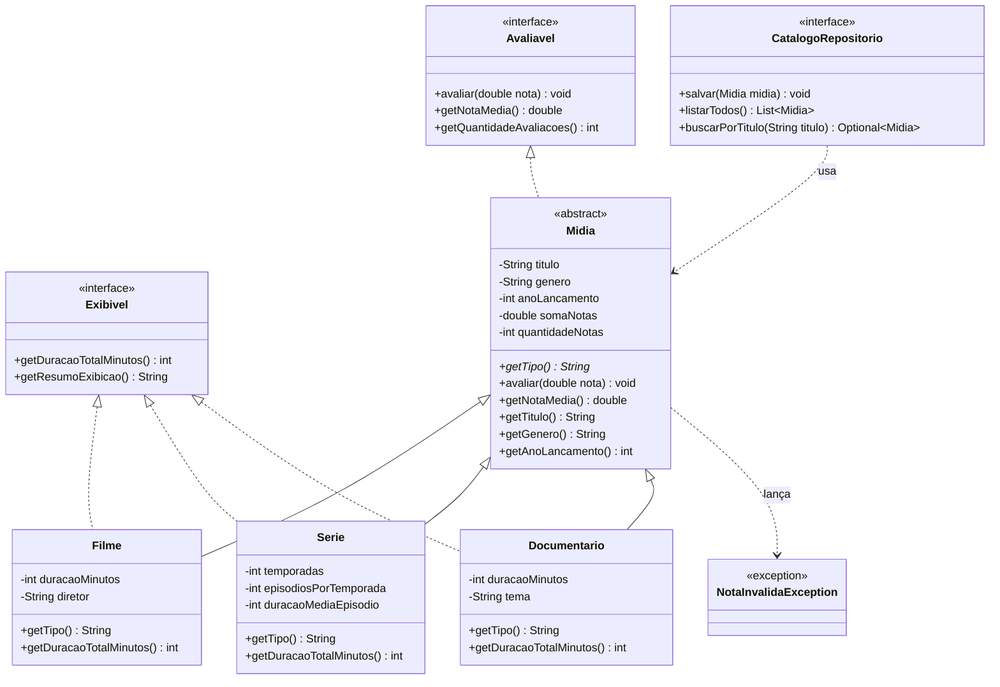
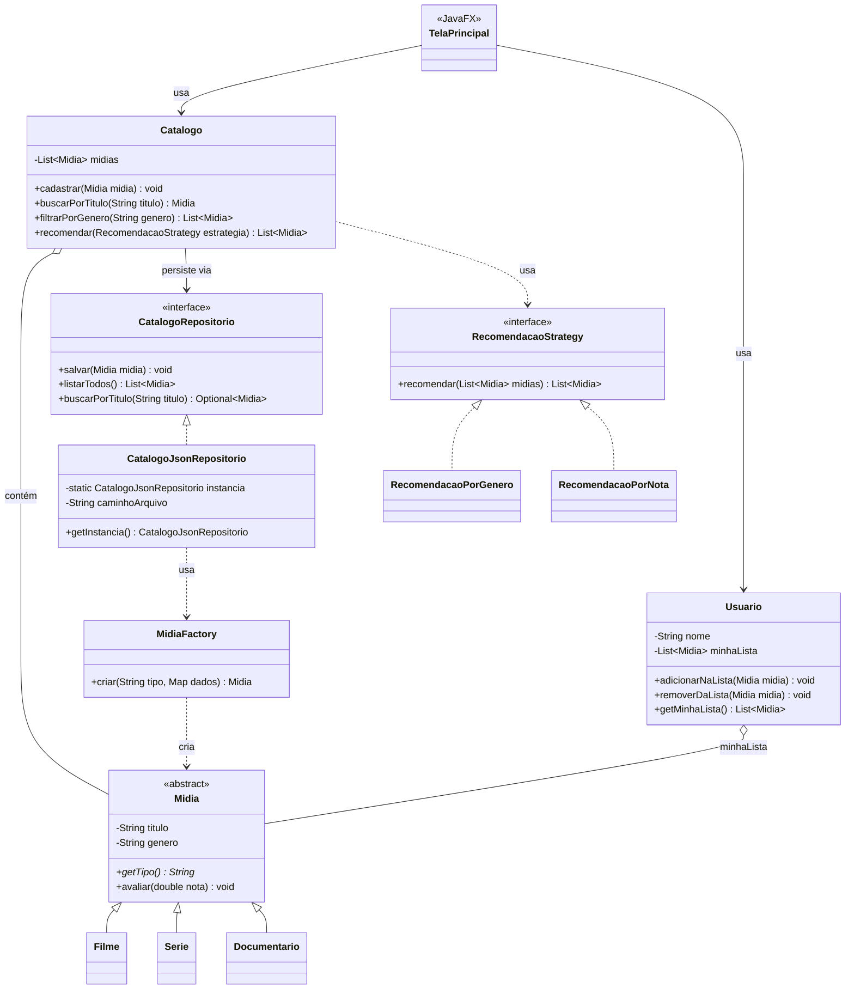

# Diagrama de classes: IMDFlix

Para editar e exportar como imagem, cole o código em https://mermaid.live.

## 1. Estado atual (para implementar)

## 2. Versão alvo

Classes a serem adicionadas `Usuario`, `Catalogo`, `CatalogoJsonRepositorio`, `MidiaFactory`, `RecomendacaoStrategy` e a camada de interface em JavaFX. Para simplificar, `Filme`, `Serie` e `Documentario` aparecem sem atributos.

## Padrões de projeto no diagrama

- **Singleton:** `CatalogoJsonRepositorio` (acesso único ao arquivo JSON).
- **Factory:** `MidiaFactory` (cria a subclasse correta de `Midia` a partir dos dados do JSON).
- **Strategy:** `RecomendacaoStrategy` e suas implementações (algoritmos de recomendação intercambiáveis).
