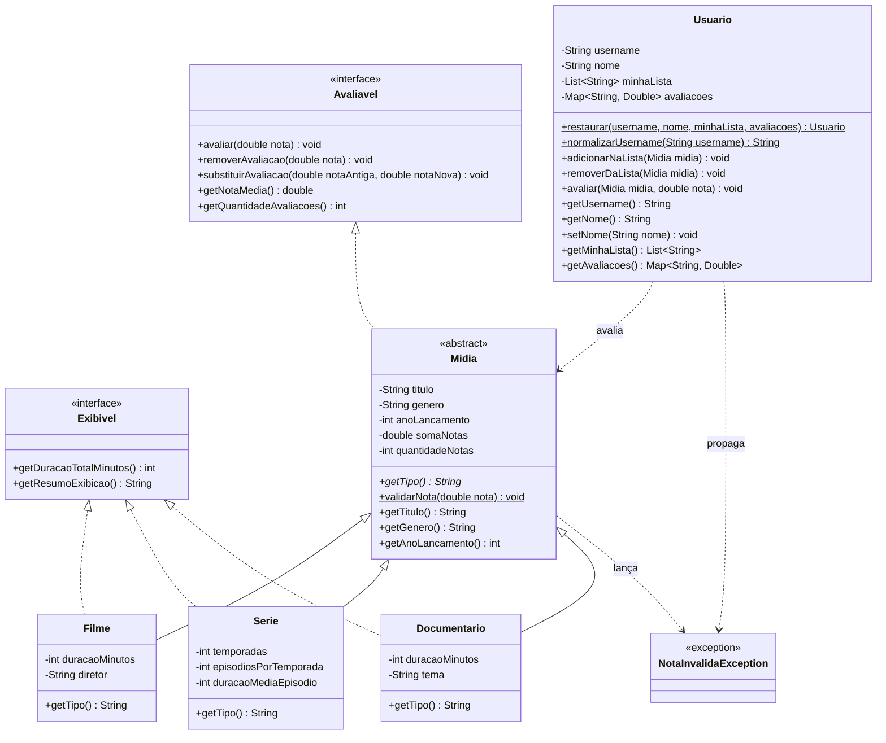
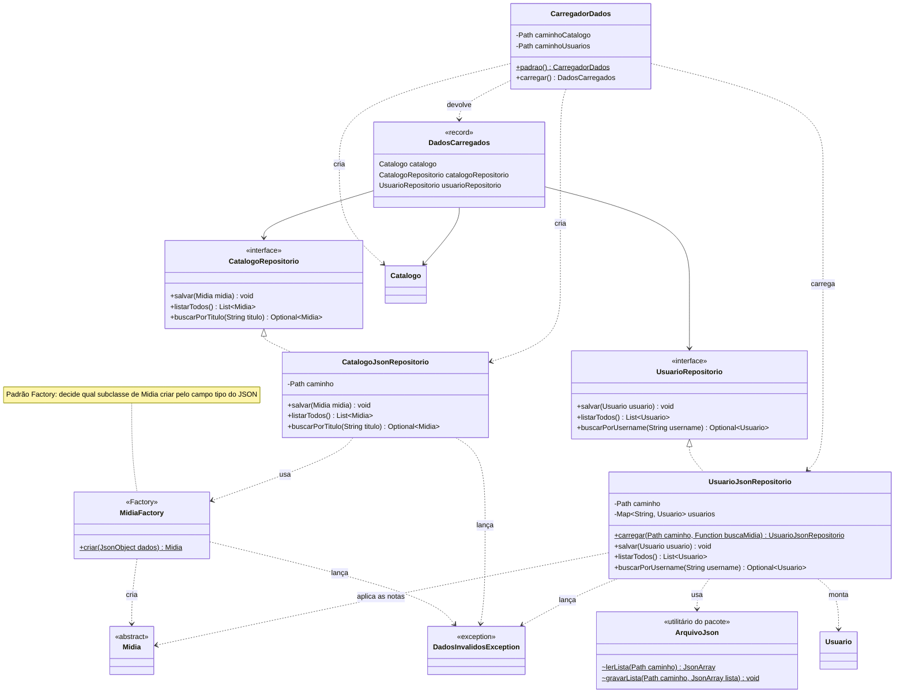
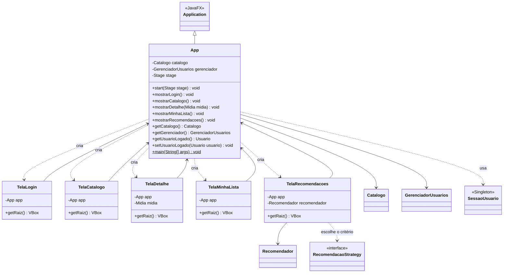

# Diagramas de classes: IMDFlix

Os diagramas foram montados a partir do código do repositório e estão divididos por assunto, para ficarem legíveis. O GitHub renderiza os blocos `mermaid` automaticamente. Para gerar imagens (PNG ou SVG) para os slides, cole o código em https://mermaid.live.

Legenda: `+` público, `-` privado, `*` método abstrato, `$` método estático, `<|--` herança, `<|..` implementação de interface, `..>` dependência (usa ou cria), `-->` associação, `o--` agregação.

## 1. Domínio: mídias, usuário e interfaces

Mostra a classe abstrata `Midia` com suas três subclasses concretas, as duas interfaces (`Avaliavel` e `Exibivel`) e o usuário. O polimorfismo acontece quando o sistema trata qualquer título como `Midia` (avaliar, mostrar o resumo de exibição) sem saber se é filme, série ou documentário.

**Encapsulamento:** todos os atributos são privados, com acesso por getters. O `Usuario` guarda os títulos (texto), não os objetos `Midia`, o que o mantém independente do catálogo carregado.

## 2. Serviços: catálogo, usuários, sessão e recomendação

Mostra onde ficam as regras do sistema e dois padrões de projeto: **Singleton** (`SessaoUsuario`) e **Strategy** (`RecomendacaoStrategy` com o contexto `Recomendador`).

```mermaid
classDiagram
    direction TB

    class Catalogo {
        -CatalogoRepositorio repositorio
        -Map~String, Midia~ midias
        +cadastrar(Midia midia) void
        +buscarPorTitulo(String titulo) Optional~Midia~
        +filtrarPorGenero(String genero) List~Midia~
        +listarTodos() List~Midia~
        +aplicarAvaliacoes(Collection~Usuario~ usuarios) void
    }

    class GerenciadorUsuarios {
        -UsuarioRepositorio repositorio
        -Map~String, Usuario~ usuarios
        +cadastrar(String username, String nome) Usuario
        +entrar(String username) Optional~Usuario~
        +salvar(Usuario usuario) void
        +listarTodos() List~Usuario~
    }

    class SessaoUsuario {
        <<Singleton>>
        -Usuario usuarioAtual
        -SessaoUsuario()
        +getInstancia()$ SessaoUsuario
        +entrar(Usuario usuario) void
        +sair() void
        +haUsuarioLogado() boolean
        +getUsuarioAtual() Optional~Usuario~
    }

    class Recomendador {
        -RecomendacaoStrategy estrategia
        +setEstrategia(RecomendacaoStrategy estrategia) void
        +getEstrategia() RecomendacaoStrategy
        +recomendar(Usuario usuario, Catalogo catalogo, int limite) List~Midia~
    }

    class RecomendacaoStrategy {
        <<interface>>
        +getNome() String
        +getDescricao() String
        +recomendar(Usuario usuario, List catalogo, int limite) List~Midia~
    }

    class RecomendacaoPorNota {
        +getNome() String
        +getDescricao() String
        +recomendar(Usuario usuario, List catalogo, int limite) List~Midia~
    }

    class RecomendacaoPorGenero {
        +double NOTA_MINIMA_GOSTO
        +getNome() String
        +getDescricao() String
        +recomendar(Usuario usuario, List catalogo, int limite) List~Midia~
    }

    class CatalogoRepositorio {
        <<interface>>
    }
    class UsuarioRepositorio {
        <<interface>>
    }
    class Midia {
        <<abstract>>
    }
    class Usuario
    class TituloDuplicadoException {
        <<exception>>
    }
    class UsernameJaExisteException {
        <<exception>>
    }

    Catalogo --> CatalogoRepositorio : persiste via
    Catalogo "1" o-- "*" Midia : contém
    GerenciadorUsuarios --> UsuarioRepositorio : persiste via
    GerenciadorUsuarios "1" o-- "*" Usuario : contém
    SessaoUsuario --> "0..1" Usuario : usuarioAtual

    Recomendador --> RecomendacaoStrategy : estrategia
    Recomendador ..> Catalogo : lê os títulos
    RecomendacaoStrategy <|.. RecomendacaoPorNota
    RecomendacaoStrategy <|.. RecomendacaoPorGenero
    RecomendacaoStrategy ..> Usuario : usa
    RecomendacaoStrategy ..> Midia : recomenda

    Catalogo ..> TituloDuplicadoException : lança
    GerenciadorUsuarios ..> UsernameJaExisteException : lança

    note for SessaoUsuario "Padrão Singleton: um único usuário logado, compartilhado por todas as telas"
    note for RecomendacaoStrategy "Padrão Strategy: cada critério de recomendação é um algoritmo intercambiável"
```

## 3. Persistência e carregamento dos dados

Mostra as interfaces de repositório (o restante do sistema depende delas, não do JSON), as implementações em JSON, o padrão **Factory** (`MidiaFactory`) e o `CarregadorDados`, que garante a ordem: primeiro o catálogo, depois os usuários.

## 4. Interface gráfica (JavaFX)

As telas só apresentam dados e chamam os serviços; nenhuma regra de negócio fica nelas. O `App` controla a troca de telas.

## Onde cada padrão e conceito aparece

| Item exigido | Onde está |
|---|---|
| Classe abstrata com subclasses concretas | `Midia` com `Filme`, `Serie` e `Documentario` |
| Interfaces usadas de forma polimórfica | `Avaliavel` (em `Midia`), `Exibivel` (nas três subclasses) e `RecomendacaoStrategy` |
| Encapsulamento | atributos privados em todas as classes do domínio |
| Padrão Factory | `MidiaFactory` |
| Padrão Singleton | `SessaoUsuario` |
| Padrão Strategy | `RecomendacaoStrategy`, `RecomendacaoPorNota`, `RecomendacaoPorGenero` e `Recomendador` |
| Tratamento de exceções | `NotaInvalidaException`, `TituloDuplicadoException`, `UsernameJaExisteException` e `DadosInvalidosException` |
| Extra (interface gráfica) | pacote `ui`, em JavaFX |
