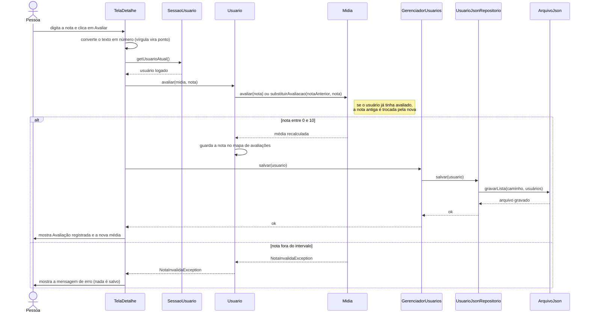
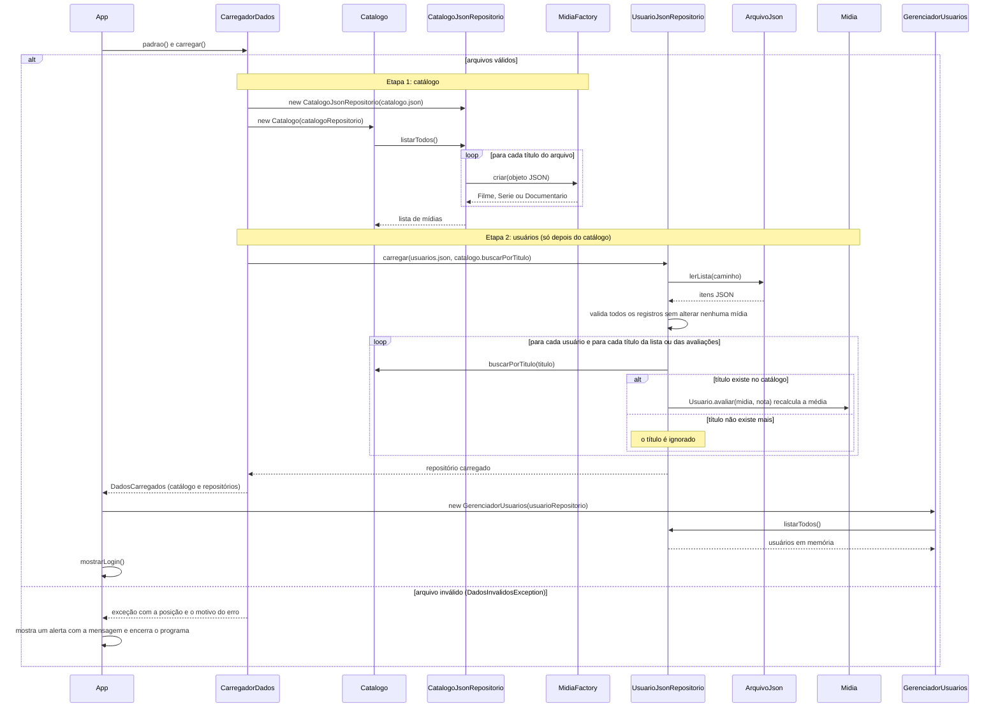
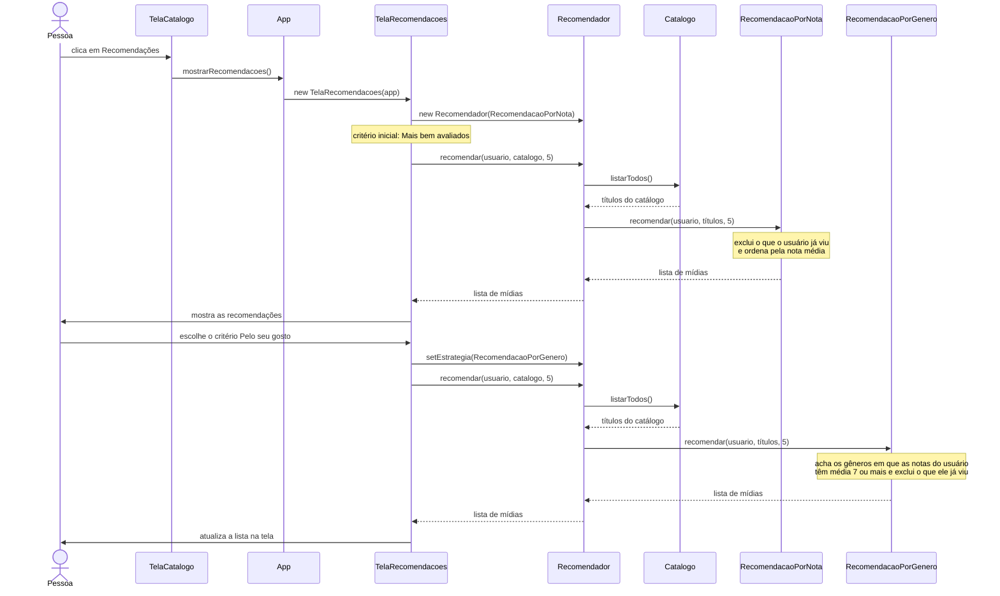

# Diagramas de sequência: IMDFlix

Os fluxos foram montados a partir do código do repositório. O GitHub renderiza os blocos `mermaid` automaticamente. Para gerar imagens para os slides, cole o código em https://mermaid.live.

## 1. Usuário avalia um título

É o fluxo principal do sistema: mostra a tela, a sessão (Singleton), o modelo, a validação com exceção e a gravação no arquivo JSON.

Outros erros tratados pela tela: texto que não é número (`NumberFormatException`, com a mensagem "Digite um número") e falha ao gravar o arquivo (`IOException`, com a mensagem "Erro ao salvar os dados").

## 2. Inicialização: carregar os dados

Mostra a ordem obrigatória: o catálogo é carregado **antes** dos usuários, porque as notas dos usuários são aplicadas nas mídias do catálogo para recalcular as médias. Títulos que não existem mais no catálogo são ignorados.

## 3. Recomendações e troca de estratégia (Strategy)

Mostra o padrão Strategy em ação: o `Recomendador` delega o cálculo à estratégia atual, e a tela pode trocá-la em tempo de execução sem alterar o `Recomendador`.

